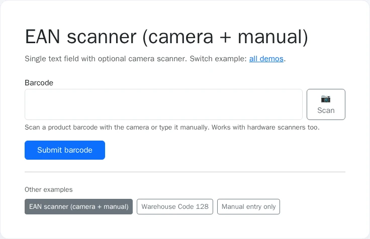
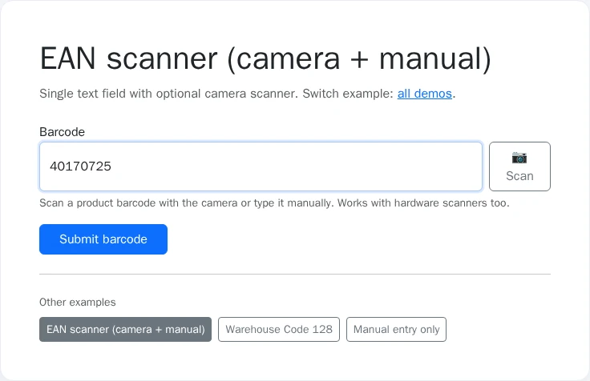

# Usage

## Screenshots

| Overview | Interaction |
|----------|-------------|
|  |  |

Regenerate with `make -C demo/symfony8 demo-screenshots` (REQ-DEMO-013).


## Table of contents

- [Screenshots](#screenshots)

- [Form type](#form-type)
- [Frontend script](#frontend-script)
- [Customization](#customization)
- [Twig template overrides](#twig-template-overrides)
- [Using it from a DDD / hexagonal application](#using-it-from-a-ddd--hexagonal-application)

## Form type

Use `BarcodeType` in any Symfony form:

```php
use Nowo\BarcodeInputBundle\Form\BarcodeType;

$builder->add('barcode', BarcodeType::class, [
    'enable_scanner' => true,
    'max_length' => 64,
    'formats' => ['ean_13', 'code_128', 'code_39'],
    'facing_mode' => 'environment',
    'container_class' => 'nowo-barcode-input__container',
    'input_class' => 'form-control',
    'button_class' => 'btn btn-outline-secondary',
    'autofocus' => true,
]);
```

The field value is a single string, for example `40170725`.

## Frontend script

Include the built barcode script in your layout (after `assets:install`):

```twig
<script src="{{ asset('barcode-input.js', 'nowo_barcode_input') }}"></script>
```

The `nowo_barcode_input` package maps to `/bundles/nowobarcodeinput` (the path created by `assets:install`).

The script defines the `<nowo-barcode-input>` custom element and initializes legacy `[data-nowo-barcode-container="1"]` wrappers.

## Customization

- `enable_scanner`: show camera scan button when true
- `max_length`: maximum characters (1–256); longer submissions fail validation instead of being truncated
- `trim_whitespace` / `strip_non_printable`: server-side normalization
- `formats`: non-empty list of symbology hints for camera scanning (`ean_13`, `ean_8`, `upc_a`, `upc_e`, `code_128`, `code_39`, `itf`, `codabar`); unknown values throw `InvalidOptionsException`
- `facing_mode`: `environment` (rear) or `user` (front) camera
- `container_class`, `input_class`, `button_class`: CSS hooks
- `autofocus`: focus the text input on load

Hardware wedge scanners work out of the box: they type into the focused text input like a keyboard.

## Twig template overrides

The bundle registers its Twig views so that `@NowoBarcodeInputBundle/...` works, and it adds its view path **after** the application paths. Overrides under **`templates/bundles/NowoBarcodeInputBundle/`** are therefore checked first.

Use the directory name **`NowoBarcodeInputBundle`** (matches `Bundle::getName()`).

| Bundle path under `src/Resources/views/` | Application override |
| ---------------------------------------- | -------------------- |
| `Form/barcode_input_theme.html.twig` | `templates/bundles/NowoBarcodeInputBundle/Form/barcode_input_theme.html.twig` |
| `Form/barcode_input_theme_table.html.twig` | `templates/bundles/NowoBarcodeInputBundle/Form/barcode_input_theme_table.html.twig` |
| `Form/barcode_input_theme_bootstrap5.html.twig` | `templates/bundles/NowoBarcodeInputBundle/Form/barcode_input_theme_bootstrap5.html.twig` |
| `Form/barcode_input_theme_bootstrap5_horizontal.html.twig` | `templates/bundles/NowoBarcodeInputBundle/Form/barcode_input_theme_bootstrap5_horizontal.html.twig` |
| `Form/barcode_input_theme_bootstrap4.html.twig` | `templates/bundles/NowoBarcodeInputBundle/Form/barcode_input_theme_bootstrap4.html.twig` |
| `Form/barcode_input_theme_bootstrap4_horizontal.html.twig` | `templates/bundles/NowoBarcodeInputBundle/Form/barcode_input_theme_bootstrap4_horizontal.html.twig` |
| `Form/barcode_input_theme_bootstrap3.html.twig` | `templates/bundles/NowoBarcodeInputBundle/Form/barcode_input_theme_bootstrap3.html.twig` |
| `Form/barcode_input_theme_bootstrap3_horizontal.html.twig` | `templates/bundles/NowoBarcodeInputBundle/Form/barcode_input_theme_bootstrap3_horizontal.html.twig` |
| `Form/barcode_input_theme_foundation5.html.twig` | `templates/bundles/NowoBarcodeInputBundle/Form/barcode_input_theme_foundation5.html.twig` |
| `Form/barcode_input_theme_foundation6.html.twig` | `templates/bundles/NowoBarcodeInputBundle/Form/barcode_input_theme_foundation6.html.twig` |
| `Form/barcode_input_theme_tailwind2.html.twig` | `templates/bundles/NowoBarcodeInputBundle/Form/barcode_input_theme_tailwind2.html.twig` |

All form-submitting demo and host templates **must** use Symfony Forms (`form_start` / `form_row` / `form_end`), never raw `<form>` or `<input>` in page templates.

## Using it from a DDD / hexagonal application

BarcodeInputBundle is **presentation only**: a form field (`BarcodeType`, a `TextType`) with a camera scanner. It has
no entities, no events, no services your code calls and no Doctrine dependency, and it knows nothing about your model.

**Standard Symfony project (default).** Bind the field to a string property of your entity or form model
(`data_class`); the submitted value is the normalized string.

**DDD / hexagonal project (opt-in).**

- The field submits a normalized **string** (trimmed, printable ASCII only, at most `max_length` characters).
  Bind it to a property of your request/command DTO, not to a domain entity, and build your value object
  (for example `Gtin`) in the application layer, where it validates the check digit.
- To bind it directly to a value object, add your own model transformer on the child; it runs between the
  bundle's normalization and your model. Turn the value object's validation error into a
  `TransformationFailedException` so the form shows it as an invalid field:

```php
use Symfony\Component\Form\CallbackTransformer;
use Symfony\Component\Form\Exception\TransformationFailedException;

$builder->add('gtin', BarcodeType::class, ['formats' => ['ean_13']]);
$builder->get('gtin')->addModelTransformer(new CallbackTransformer(
    static fn (?Gtin $gtin): string => $gtin === null ? '' : $gtin->value,
    static function (?string $code): ?Gtin {
        try {
            return $code === null || $code === '' ? null : Gtin::fromString($code);
        } catch (InvalidGtin $e) {
            throw new TransformationFailedException($e->getMessage(), 0, $e);
        }
    },
));
```

- `formats` only tells the browser scanner which symbologies to decode; it is not server-side validation.
- There are no ports to type-hint and nothing to replace or decorate: customise through form options, form type
  extensions and the Twig theme (see [Customization](#customization) and
  [Twig template overrides](#twig-template-overrides)). There are no IDs or events.

Both paths are covered by `tests/Unit/Form/BarcodeTypeHostPathsTest.php`.

### Known limitations

- A model value that is not a string, number or `Stringable` is rendered as an empty field instead of failing; give
  value objects a model transformer (above) or `__toString()`.
- No check-digit validation; validate in your value object.
